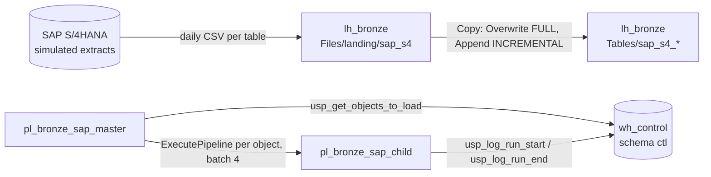

# Agentic Fabric development: SAP ingestion demo

> [!WARNING]
> **Demo only. Not for production use.** This sample is provided as is, without warranty or support, and is not an official Microsoft product. Run it only in a non-production Fabric workspace, with an identity that has no access to test or production, and review anything you reuse against your organization's security and compliance requirements.

This repo is a ready-to-use workspace for building Microsoft Fabric Data Factory pipelines with GitHub Copilot in VS Code, using the Fabric MCP server and the Fabric skills. The scenario is a metadata-driven ingestion framework that loads SAP S/4HANA tables from a landing area into bronze Delta tables, controlled by a Fabric Warehouse. The company (Contoso Drilling Systems) and all data are fictional and synthetic.

The question the demo answers: can an agent build pipelines that open in Fabric and have the right connections? It can, if it reads the real workspace state through a read-only MCP server, follows written standards and validated patterns, and may change only a DEV workspace.



Copilot gets its context from [.github/copilot-instructions.md](.github/copilot-instructions.md) (environment, guardrails, how-to) and [.github/instructions/fabric-pipelines.instructions.md](.github/instructions/fabric-pipelines.instructions.md). The second file holds validated pipeline JSON patterns and is applied to `fabric/**`.

## What's here

| Path | Content |
|---|---|
| `environment/` | `fabric-environment.json` is written by `provision` with your tenant, capacity, workspace, lakehouse and warehouse IDs and endpoints (no secrets). It is gitignored; `fabric-environment.example.json` shows its shape |
| `docs/design/ingestion-framework.md` | Framework design: landing, control tables, stored procedures, pipeline contracts |
| `docs/standards/` | Naming standards and bronze layer rules |
| `docs/demo-runbook.md` | 30-minute session plan, pre-flight checklist and fallbacks |
| `.github/skills/` | On-demand skills for the session: `/demo-1-read-state`, `/demo-2-build-pipelines`, `/demo-3-incremental-load`, `/demo-4-catchup` |
| `.mcp.json` | Portable MCP config for the Copilot harness and the Copilot CLI: `fabricReadOnly` (read-only), `fabricDevWrite` (six allow-listed write tools) and `microsoftLearn` |
| `fabric/` | Pipeline definitions in Fabric Git format. Copilot writes here; on `main` it holds only a README |
| `fallback` branch | Validated reference pipelines, used by `deploy-reference`. They are kept off `main` so the agent builds its own |
| `data/sap_s4/` | Synthetic SAP extracts: 10 tables × 7 daily load dates (generated by `scripts/generate_sap_sample_data.py`) |
| `metadata/ingestion_config.csv` | Seed for `ctl.ingestion_config` |
| `sql/wh_control/` | Control schema, views and stored procedures |
| `scripts/fabric_env.py` | Provision, status, SQL, deploy, run, reset and grant access (Python standard library + Azure CLI) |
| `infra/capacity-autopause.json` | Optional Logic App with a managed identity that suspends capacities at 15:00 and 22:00 UTC if they are running |

## Prerequisites

- A Fabric capacity on which you are admin or contributor. A small F SKU is enough; the demo was built on an F8.
- Permission to create workspaces in Fabric.
- VS Code with GitHub Copilot (agent mode).
- Azure CLI.
- .NET 10 SDK for `dnx`. Alternatively use Node.js 22+: in `.mcp.json`, set `"command": "npx"` and replace the first three arguments (`"Microsoft.Fabric.Mcp@1.8.0", "--yes", "--"`) with `"-y", "@microsoft/fabric-mcp@1.8.0"`.
- Python 3.9+ and [go-sqlcmd](https://github.com/microsoft/go-sqlcmd/releases) for the helper script.

## Set up the environment (once)

1. **Sign in to your tenant.** The helper script and both MCP servers use the Azure CLI identity.
   ```bash
   az login --tenant <tenant-id>
   ```
   Add `--allow-no-subscriptions` if your account has no Azure subscription. Without one, `provision` can't find the capacity's Azure resource ID, which the resume and suspend commands in the runbook need.
2. **Create the workspace and items.** This creates (or finds) the workspace `Agentic SAP Demo - DEV` with `lh_bronze` and `wh_control`, and writes `environment/fabric-environment.json`. Use `--workspace-name` to pick another name.
   ```bash
   python scripts/fabric_env.py provision --capacity <capacity name or ID>
   ```
3. **Upload the landing files and create the control layer.**
   ```bash
   python scripts/fabric_env.py upload-data
   python scripts/fabric_env.py control-db
   python scripts/fabric_env.py status
   ```
4. **Give presenters access.** Contributor on the DEV workspace is enough for every step.
   ```bash
   python scripts/fabric_env.py grant --principal-id <entra-object-id> --role Contributor
   ```

The data in `data/sap_s4/` is committed. `python scripts/generate_sap_sample_data.py` regenerates exactly the same files.

## Run the demo from VS Code

1. **Install the Fabric skills** (recommended), with either the Copilot CLI or VS Code:
   - Copilot CLI:
     ```bash
     copilot plugin marketplace add microsoft/skills-for-fabric
     copilot plugin install fabric-skills@fabric-collection
     ```
   - VS Code: run **Chat: Install Plugin from Source** with `https://github.com/microsoft/skills-for-fabric`.
2. **Start the MCP servers.** Open this folder in VS Code and use the **Copilot** harness in Chat. The configuration is the portable `.mcp.json`, so the deprecated Local harness doesn't load it. Run **Chat: Open Customizations**, select **MCP Servers**, then start and trust `fabricReadOnly` and `fabricDevWrite`. If other Fabric MCP servers are configured in your user profile, disable them for this workspace so that Copilot only has the guarded ones.
3. **Run the skills** as slash commands in a normal agent session, not Autopilot. The Fabric MCP server asks for approval before running a pipeline, and Autopilot cancels that request. Start with `/demo-1-read-state`, then `/demo-2-build-pipelines`, `/demo-3-incremental-load` and optionally `/demo-4-catchup`.

[docs/demo-runbook.md](docs/demo-runbook.md) has the timed session plan and the fallbacks.

## Guardrails

These map to "agents may read state, and change only what we allow":

- **`fabricReadOnly`** runs with `--read-only`, so write tools are not even listed.
- **`fabricDevWrite`** exposes exactly six tools: create item, get and update item definition, and run, get and cancel a job. The server's `--tool` flags and the `tools` list in `.mcp.json` both enforce this. Running a job triggers an approval prompt.
- **Fabric RBAC is the hard boundary.** The Fabric MCP server has no workspace allow-list: it can reach every workspace its identity can. Run the demo with an identity that has Contributor on the DEV workspace only, and no access to test or production workspaces.
- **Git first.** Definitions are written to `fabric/` before deployment and deployed from those files.

## Helper commands

```bash
python scripts/fabric_env.py status                         # capacity state, items, access
python scripts/fabric_env.py sql "SELECT * FROM ctl.v_run_status ORDER BY started_at DESC"
python scripts/fabric_env.py sql --target lakehouse "SELECT _LOAD_DATE, COUNT(*) FROM dbo.sap_s4_ekpo GROUP BY _LOAD_DATE"
python scripts/fabric_env.py deploy fabric/<name>.DataPipeline
python scripts/fabric_env.py run pl_bronze_sap_master -p p_load_date=2026-11-12
python scripts/fabric_env.py deploy-reference   # validated pipelines from the fallback branch, then one run (--no-run to skip)
python scripts/fabric_env.py reset          # dry run; add --yes to delete pipelines and bronze tables and reseed ctl
python scripts/fabric_env.py grant --principal-id <entra-object-id> --role Contributor
```

`deploy-reference` reads the definitions from `origin/fallback`, so run it from a Git clone, not a downloaded ZIP.

## Cost control (optional)

`infra/capacity-autopause.json` deploys a Logic App that suspends the listed capacities at 15:00 and 22:00 UTC if they are running. Deploy it, then give its managed identity Contributor on each capacity:

```bash
az deployment group create -g <resource-group> --template-file infra/capacity-autopause.json \
  --parameters capacityIds='["<capacity ARM ID>"]'
az role assignment create --assignee <principalId from the deployment output> --role Contributor --scope "<capacity ARM ID>"
```

Resume the capacity before a session, as described in the runbook.
