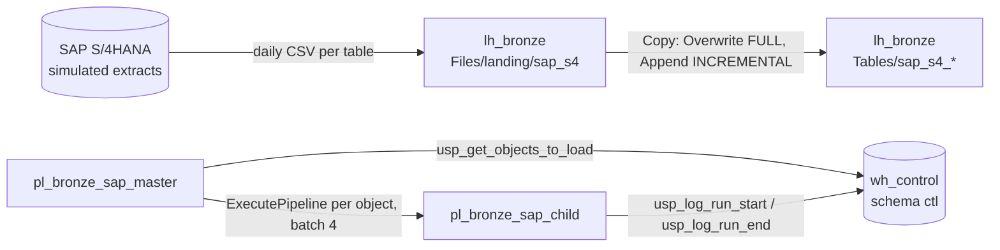

# Ingestion framework design: SAP S/4HANA to bronze

## Scope

This document covers the bronze layer for SAP S/4HANA tables. It describes a metadata-driven framework that a daily schedule (or a person) starts with a load date. Silver and gold come later.

The SAP extraction is simulated. Files appear in the landing area as if an SAP connector or an ODP delta extraction had produced them.



## Landing area

- **Path.** `lh_bronze` → `Files/landing/sap_s4/<TABLE>/load_date=YYYY-MM-DD/<TABLE>_YYYYMMDD.csv`.
- **Format.** CSV with a header row, comma-separated, UTF-8. Values are SAP internal formats: dates as `YYYYMMDD` and keys with leading zeros.
- **Load types.**
  - **Master data** (FULL: `T001W`, `MARA`, `MAKT`, `LFA1`, `KNA1`). Each load date holds a complete snapshot.
  - **Transactions** (INCREMENTAL: `EKKO`, `EKPO`, `VBAK`, `VBAP`, `MATDOC`). Each load date holds only the records created or changed that day. `ODQ_CHANGEMODE` is `C` for create and `U` for update.
- **Extraction timestamp.** Every file has `_EXTRACT_TS`.
- **Available dates.** 2026-11-12 to 2026-11-18. Weekends (14–15 November) have few or no transactions.
- **Immutable.** Landing files are never changed or deleted by pipelines.

## Control layer: `wh_control`, schema `ctl`

| Object | Purpose |
|---|---|
| `ctl.ingestion_config` | One row per source object: `load_group` (`SAP_MASTERDATA` or `SAP_TRANSACTIONS`), `load_type` (`FULL` or `INCREMENTAL`), `business_key`, `landing_folder`, `target_table`, `priority`, `is_active`. Seeded from `metadata/ingestion_config.csv` |
| `ctl.watermark` | Append-only. One row per successful load (`load_date`, `rows_copied`, `pipeline_run_id`) |
| `ctl.run_log` | Append-only. One `Started` event and one `Succeeded` or `Failed` event per child run |
| `ctl.v_watermark` | Latest watermark per object |
| `ctl.v_run_status` | One row per child run: status, rows, error, duration |

The tables are append-only on purpose. Fabric Warehouse detects write conflicts per table, so parallel child runs that UPDATE the same table abort each other. Inserts don't conflict.

### Stored procedure contracts

| Procedure | Parameters | Behaviour |
|---|---|---|
| `ctl.usp_get_objects_to_load` | `@load_group` (`ALL` or a group), `@load_date` | Returns active objects with `source_system`, `source_object`, `load_type`, `target_table`, `landing_path`, `table_action` (`Overwrite`/`Append`) and `load_date`. INCREMENTAL objects whose watermark already covers `@load_date` are skipped, which makes reruns safe |
| `ctl.usp_log_run_start` | `@pipeline_run_id`, `@parent_run_id`, `@pipeline_name`, `@source_system`, `@source_object`, `@load_date` | Inserts a `Started` event |
| `ctl.usp_log_run_end` | `@pipeline_run_id`, `@pipeline_name`, `@source_system`, `@source_object`, `@load_date`, `@status`, `@rows_copied`, `@error_message` | Inserts the end event. On `Succeeded` it also inserts a watermark row |

## Pipelines

### `pl_bronze_sap_master`

Parameters:

| Parameter | Default | Meaning |
|---|---|---|
| `p_load_group` | `ALL` | `ALL`, `SAP_MASTERDATA` or `SAP_TRANSACTIONS` |
| `p_load_date` | empty | `YYYY-MM-DD`. Empty means yesterday (UTC) |

Activities:

1. **Set load date** writes `v_load_date`: the parameter if given, otherwise yesterday.
2. **Get objects to load** is a Lookup that calls `ctl.usp_get_objects_to_load`.
3. **For each object** runs in parallel with batch count 4. Inside, **Load object to bronze** is an ExecutePipeline call to `pl_bronze_sap_child`, waiting for completion and passing the row's columns plus `p_parent_run_id = @pipeline().RunId`.

If any child fails, the ForEach fails, and so does the master run. The other objects still load.

### `pl_bronze_sap_child`

Parameters: `p_source_system`, `p_source_object`, `p_landing_path`, `p_target_table`, `p_table_action`, `p_load_date`, `p_parent_run_id`.

Activities:

1. **Log run start** calls `ctl.usp_log_run_start`.
2. **Copy landing to bronze** copies all `*.csv` files in `Files/<p_landing_path>` into table `<p_target_table>`. `tableActionOption` is `p_table_action`. It adds the lineage columns `_LOAD_DATE`, `_SOURCE_FILE` and `_PIPELINE_RUN_ID`.
3. **Log run end - succeeded** runs when the copy succeeds. It calls `ctl.usp_log_run_end` with `Succeeded` and `rowsCopied`.
4. **Log run end - failed** runs when the copy fails. It calls `ctl.usp_log_run_end` with `Failed` and the copy's error message.
5. **Fail pipeline** runs after the failure has been logged. It fails the run with error code `BRONZE_LOAD_FAILED`.

## Run, rerun and restart

- **Daily run.** `pl_bronze_sap_master` with an empty `p_load_date`.
- **A given day.** Set `p_load_date`, for example `2026-11-12` for the initial load and `2026-11-13` for the next increment.
- **Rerun the same date.** FULL objects reload, which is harmless because they overwrite. INCREMENTAL objects that already succeeded are skipped, and only failed or missing ones load.
- **No catch-up yet.** Missing days must be run in date order. This is a possible extension.

## Verification queries

```sql
-- wh_control
SELECT * FROM ctl.v_run_status ORDER BY started_at DESC;
SELECT * FROM ctl.v_watermark ORDER BY source_object;
EXEC ctl.usp_get_objects_to_load @load_group = 'ALL', @load_date = '2026-11-13';

-- lh_bronze SQL endpoint (refresh metadata first: scripts/fabric_env.py does it)
SELECT _LOAD_DATE, COUNT(*) FROM dbo.sap_s4_ekpo GROUP BY _LOAD_DATE;
```

## Out of scope / next steps

- Catch-up over a date range.
- Schema drift handling.
- Silver: deduplicate on `business_key`, keep the latest `ODQ_CHANGEMODE` and `_LOAD_DATE`, apply types and business names.
- A Variable Library for environment-specific IDs.
- Promotion through Git and deployment pipelines.
